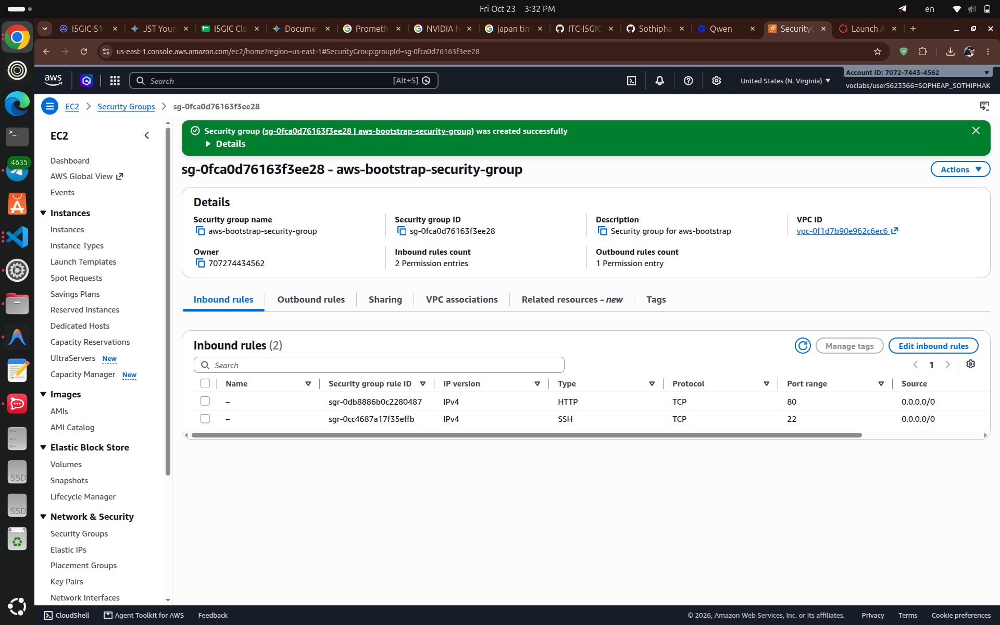
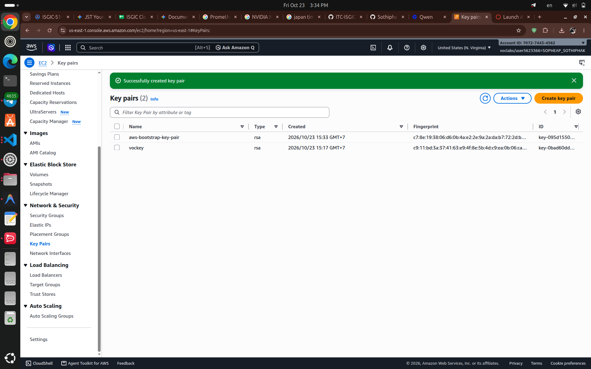
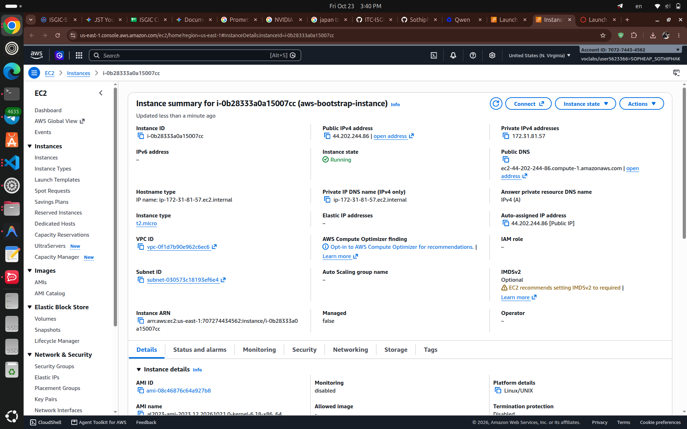
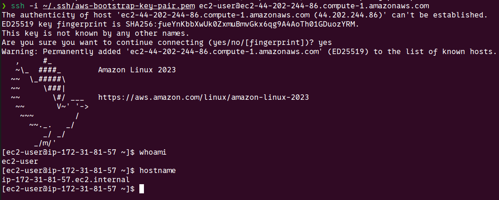
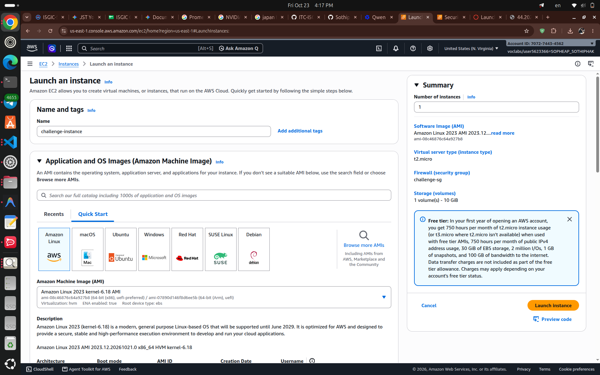
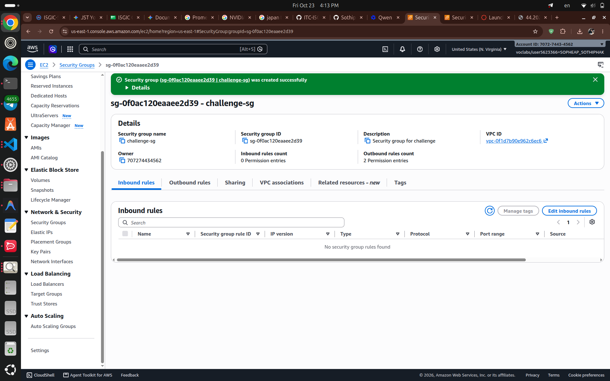
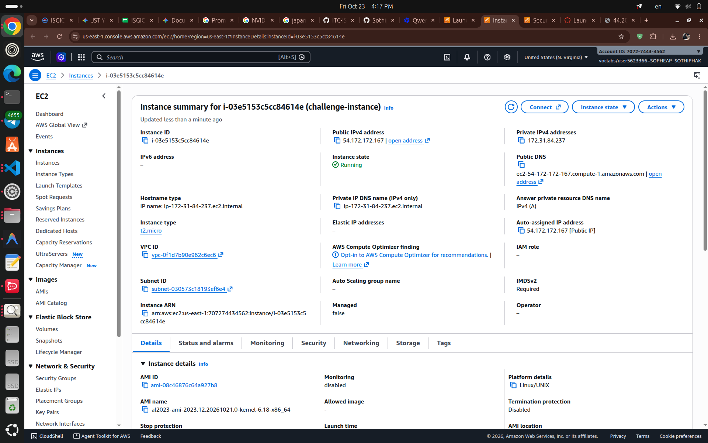
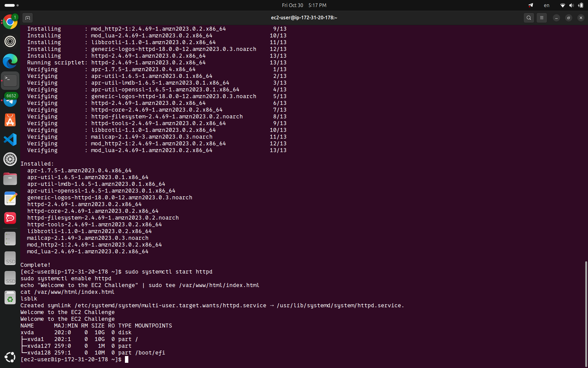

# Cloud Lab 1 Submission — Amazon EC2

- **Student name:** Sopheap Sothiphak
- **Student ID:** e20221038
- **Learner Lab user name:** SOPHEAP_SOTHIPHAK (voclabs/user5623366)
- **Date completed:** 2026-10-23 (Part 1.1) / 2026-10-24 (Part 1.2)

---

## Part 1.1 — An Amazon EC2 Walkthrough

### Security group



Created `aws-bootstrap-security-group` in the default VPC with inbound rules for SSH (TCP 22) and HTTP (TCP 80), both from Anywhere-IPv4 (0.0.0.0/0). Outbound rules left at the default allow-all.

### Key pair



Created RSA key pair `aws-bootstrap-key-pair` in `.pem` format. The private key lives at `~/.ssh/aws-bootstrap-key-pair.pem` with permission `400`, outside the course folder and never committed to Git.

### Instance details



`aws-bootstrap-instance` (i-0b28333a0a15007cc): Amazon Linux 2023 AMI, type `t2.micro`, public IPv4 `44.202.244.86`, state *Running*.

### Browser test


Opened `http://44.202.244.86` (http, not https) and the page showed *Hello World from Educative(...)*, served by the httpd installed by the user data script.

### SSH connection



Connected with my own OpenSSH client:
`ssh -i ~/.ssh/aws-bootstrap-key-pair.pem ec2-user@ec2-44-202-244-86.compute-1.amazonaws.com`
`whoami` returned `ec2-user` and `hostname` returned the instance host name.

Did you connect with your own SSH client or with EC2 Instance Connect?

I used my own SSH client (OpenSSH) from my Linux terminal.

---

## Part 1.2 — EC2 Web Solution (Challenge)

### Launch configuration



Launched `challenge-instance` from the Amazon Linux 2023 AMI (64-bit x86), instance type `t2.micro`, with key pair `challenge-key` and security group `challenge-sg`. In **Configure storage** I set the root volume to **10 GiB** gp3 and kept auto-assign public IP enabled. No user data was used — the web server was installed manually after login.

### Security group



`challenge-sg` allows inbound **SSH (TCP 22)** and **HTTP (TCP 80)**, both from Anywhere-IPv4 (0.0.0.0/0); outbound rules left at the default allow-all.

### Running instance



The instance reached state *Running* with public IPv4 `13.221.115.225` (public DNS `ec2-13-221-115-225.compute-1.amazonaws.com`).

### Commands on the instance

Paste the commands you ran to install the web server and create `index.html`:

```
ssh -i ~/.ssh/challenge-key.pem ec2-user@13.221.115.225
sudo dnf install -y httpd
sudo systemctl start httpd
sudo systemctl enable httpd
echo "Welcome to the EC2 Challenge" | sudo tee /var/www/html/index.html
cat /var/www/html/index.html
lsblk
```



`cat` printed *Welcome to the EC2 Challenge* and `lsblk` confirmed the 10 GiB root volume.

### Browser test


Opening the instance in a browser displayed *Welcome to the EC2 Challenge*. My campus web filter blocks raw IP addresses, so I loaded the page through the instance's public DNS name `http://ec2-13-221-115-225.compute-1.amazonaws.com`, which resolves to the same public IP.

---

## Questions

1. The SSH rule (TCP 22) lets me administer the instance remotely with an SSH client or EC2 Instance Connect. The HTTP rule (TCP 80) lets web traffic reach the server so anyone can load the page in a browser. If I deleted the HTTP rule, the website would stop loading (the browser would time out), while SSH access would keep working.

2. The **user data** script I pasted in the launch wizard installed it. EC2 runs user data automatically once, at the instance's first boot, so `httpd` was installed, started, enabled and `index.html` created without me ever logging in.

3. Because `httpd` only listens for plain HTTP on port 80. HTTPS needs TLS with a certificate on port 443, which I never configured (and my security group does not open 443), so `https://` cannot connect.

4. I set it in the **Configure storage** section of the launch wizard, changing the root EBS volume from the default 8 GiB to 10 GiB. On the running instance I can verify it in the console (instance → Storage tab shows 10 GiB) or from inside with `lsblk` / `df -h /`, which show a 10G root device.

## Problems and how I solved them (optional)

- When creating the first security group, the console blocked me: the description field only contained placeholder text and no VPC was selected. I typed the real description and chose the default VPC, then creation succeeded.
- My first challenge instance had been stopped when the Learner Lab session ended; after it started again, package downloads timed out (curl error 28 on the repository endpoint). I terminated it and launched a fresh instance, after which `dnf` worked.
- My campus Fortinet web filter blocks browsers from opening raw IP addresses ("FortiGuard – Access Blocked, Category: Unrated"). I verified the server with `curl http://localhost` on the instance and reached the page from my browser using the instance's public DNS name, as described in the Browser test section.

## AI note (optional)

I used an AI assistant to review my launch configuration and draft this report. I checked every suggestion against the lab instructions and verified it in AWS (for example, by loading the page at the public IP before taking screenshots).

## Clean up

- [x] Part 1.1: instance terminated, key pair and security group deleted.
- [x] Part 1.2: instance terminated, security group (and key pair, if any) deleted.