# Cloud Lab 2 Submission — Load Balancer and Auto Scaling

- **Student name:** Sopheap Sothiphak
- **Student ID:** e20221038
- **Learner Lab user name:** SOPHEAP_SOTHIPHAK
- **Date completed:** 2026-10-30

---

## Security groups

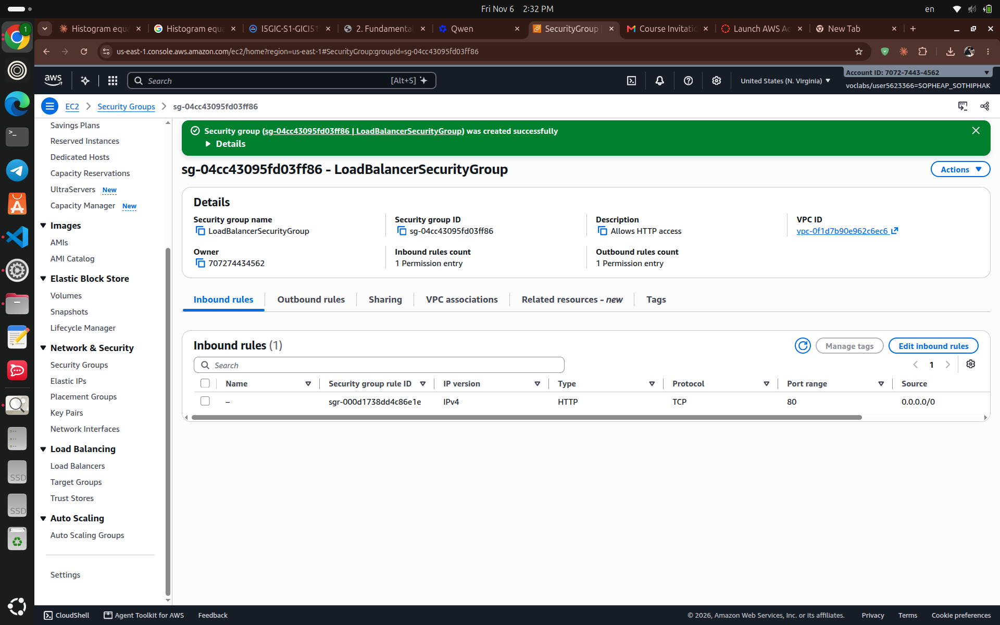
*Inbound rule: HTTP (80) from Anywhere-IPv4.*

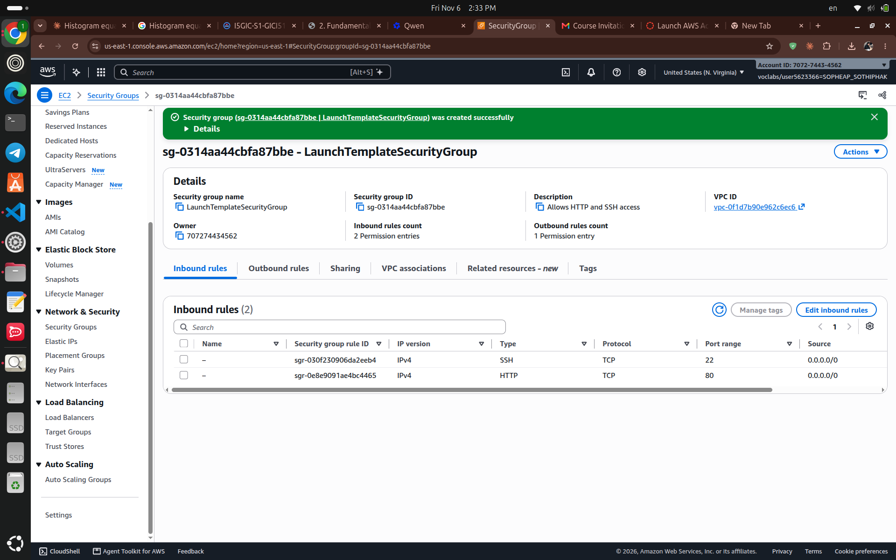
*Inbound rules: HTTP (80) and SSH (22) from Anywhere-IPv4.*

## Target group

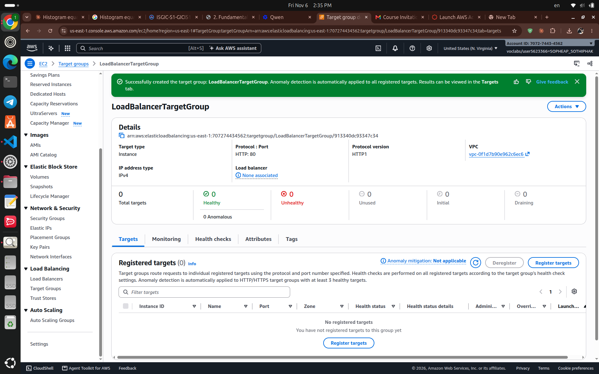
*Target group details: Instances, HTTP, port 80, default VPC.*

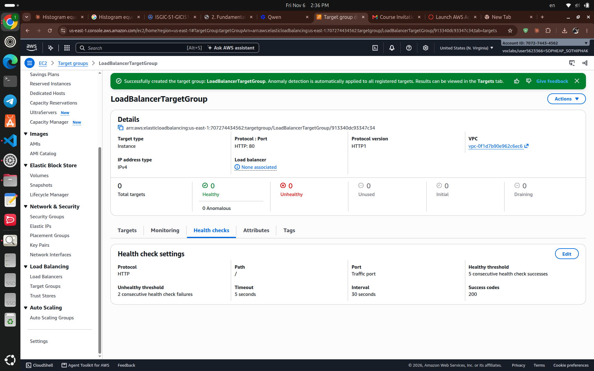
*Health check settings: HTTP, path `/`, interval 30s, threshold 2.*

## Application Load Balancer

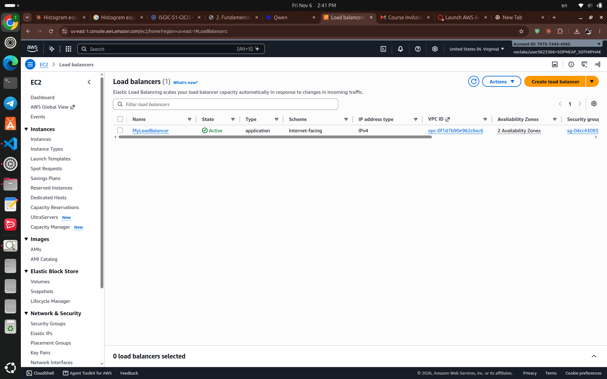
*MyLoadBalancer is Active.*

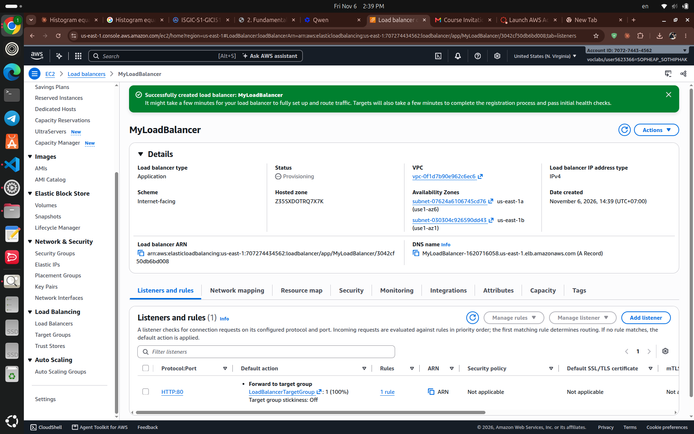
*Scheme: internet-facing, Security group: LoadBalancerSecurityGroup.*

## Launch template

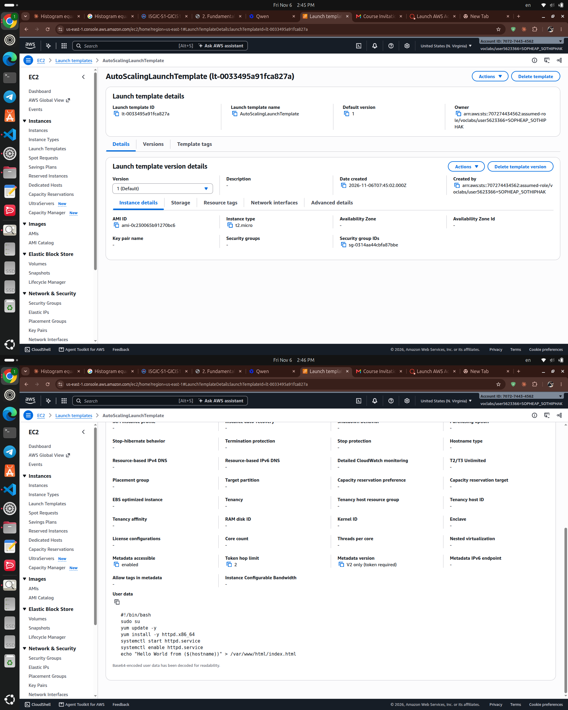
*AMI: Amazon Linux 2023, Instance type: t2.micro, User data installs httpd and serves a custom index.html.*

## Auto Scaling group

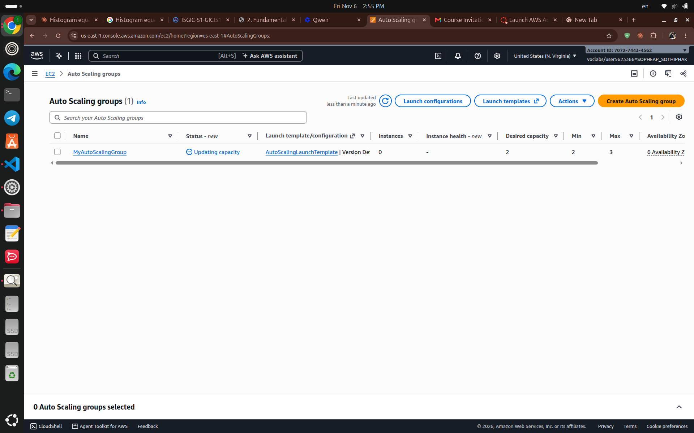
*MyAutoScalingGroup in the list.*

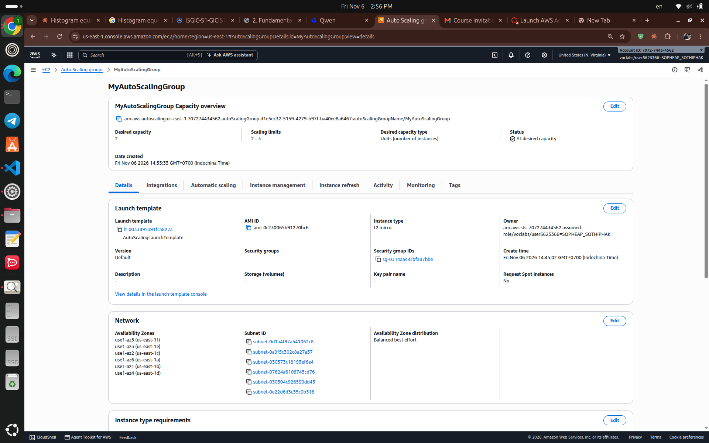
*Desired: 2, Min: 2, Max: 3. Attached to LoadBalancerTargetGroup with ELB health checks enabled.*

## Load balancing test

*Hello World from the first instance's hostname.*

*Hello World from the second instance's hostname after refreshing the page.*

## Simulated application failure

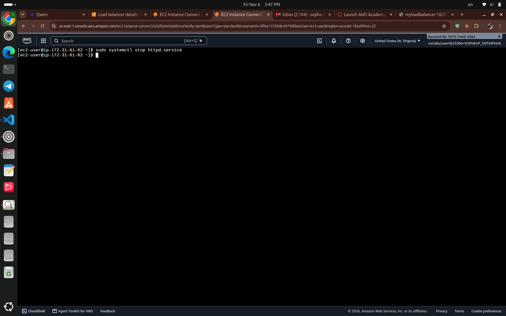
*Instance Connect terminal executing `sudo systemctl stop httpd.service`.*

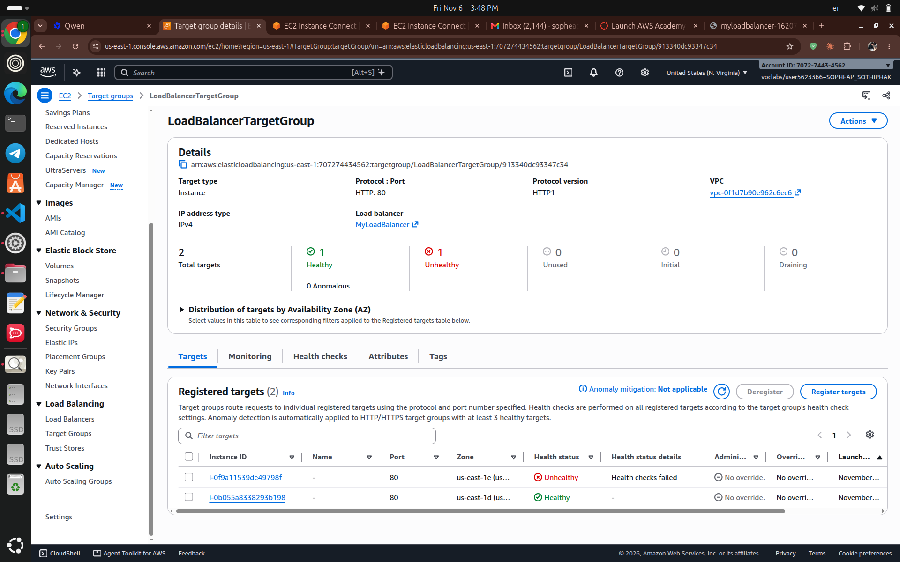
*The target group detects the failure and marks the instance Unhealthy/Draining.*

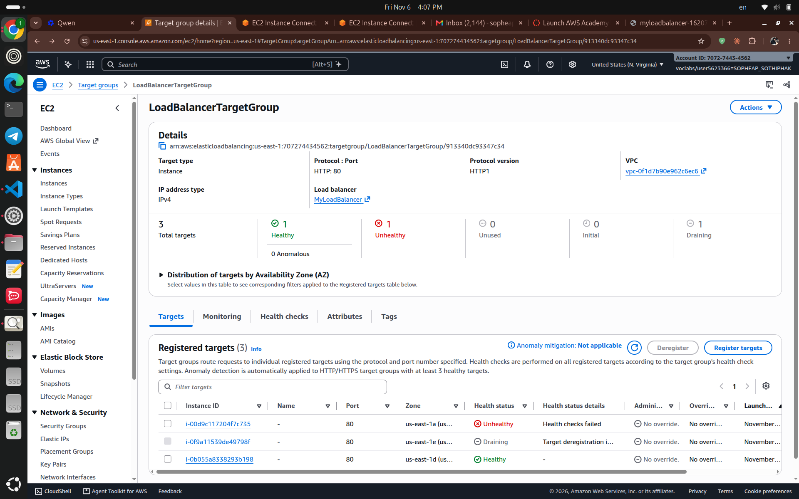
*The Auto Scaling Group launches a replacement instance, which passes health checks and becomes Healthy.*

About how many minutes passed between stopping `httpd` and the new instance becoming healthy?

It took about **5 minutes**. (1 minute for the Target Group to fail the health checks and mark it Unhealthy, a brief moment for the ASG to terminate it and launch the replacement, and ~3-4 minutes for the new instance to boot, execute the user data script to install Apache, and pass the initial health checks).

---

## Questions

1. **Why does the page show a different host name when you refresh it?**
   The Application Load Balancer distributes incoming HTTP traffic across all registered, healthy instances in the target group using a routing algorithm (like round-robin or least outstanding requests). Every time I refreshed the browser, the load balancer forwarded the request to a different EC2 instance, and because my user data script embedded the instance's hostname into the HTML file, the page displayed a different hostname.

2. **After you stopped `httpd`, the instance was still *running* in EC2, but the target group marked it *unhealthy*. What did the health check test, and why did the instance fail it?**
   The health check tested the application layer (Layer 7) by sending an HTTP GET request to the root path (`/`) on port 80. Even though the underlying EC2 instance was fully operational (passing EC2 status checks), the Apache web server process was stopped. Because no program was listening on port 80, the target group did not receive an HTTP 200 OK response, causing the health check to fail.

3. **Who replaced the failed instance: the load balancer, the target group, or the Auto Scaling group? Explain the role of each one.**
   The **Auto Scaling Group (ASG)** replaced the instance. 
   - The **Target Group's** role was to monitor application health via HTTP pings and mark the unresponsive instance as "unhealthy". 
   - The **Load Balancer's** role is to route traffic only to healthy targets, so it immediately stopped sending user traffic to the failed instance. 
   - The **ASG's** role is to maintain the desired capacity of the fleet. Because we enabled ELB health checks, the ASG received the "unhealthy" signal from the target group, terminated the broken instance, and launched a new one to return the group to its desired capacity of 2.

4. **With desired 2, minimum 2 and maximum 3, how many instances run normally? In what situation could there be 3?**
   Normally, 2 instances run because the desired and minimum capacities are both set to 2. The number of instances could increase to 3 if a scaling policy is triggered (for example, if CPU utilization across the fleet exceeds a defined threshold) and the ASG scales out up to its maximum capacity of 3 to handle increased traffic. 

5. **The instances' security group allows HTTP from anywhere. How could you change it so that the instances accept HTTP *only* from the load balancer?**
   I would edit the inbound rules of the `LaunchTemplateSecurityGroup`. Instead of setting the HTTP (port 80) source to Anywhere-IPv4 (`0.0.0.0/0`), I would change the source to the **Security Group ID** of the Load Balancer (i.e., `LoadBalancerSecurityGroup`). This ensures that only traffic originating from the load balancer is permitted to reach the instances on port 80.

## Problems and how I solved them (optional)

1. **Availability Zone mismatch (Unused targets):** Initially, my Load Balancer was only enabled in two Availability Zones, but the Auto Scaling Group launched instances in different zones. The Target Group marked them as "Unused". I solved this by selecting the Load Balancer, clicking "Edit subnets", and enabling all Availability Zones. The targets immediately became reachable.
2. **User Data script failure (IPv6 egress issue):** The initial instances launched successfully but failed the health checks because the `yum install httpd` command in the user data script was timing out over IPv6. I solved this by creating a *new version* of the Launch Template that added the command `echo "ip_resolve=4" | tee -a /etc/dnf/dnf.conf` to force IPv4 connections, then setting it as the default version and terminating the old instances.
3. **ASG not replacing the unhealthy instance:** When I stopped `httpd` to simulate a failure, the Target Group correctly marked the instance as Unhealthy, but the ASG did not terminate it. I realized I had missed the "Turn on Elastic Load Balancing health checks" checkbox during the ASG creation wizard. I edited the ASG's Health Check settings to include ELB checks, and the ASG immediately recognized the failure and replaced the instance.

## Clean up

- [x] `MyAutoScalingGroup` deleted and its instances terminated.
- [x] `AutoScalingLaunchTemplate` deleted.
- [x] `MyLoadBalancer` and `LoadBalancerTargetGroup` deleted.
- [x] Both security groups deleted.