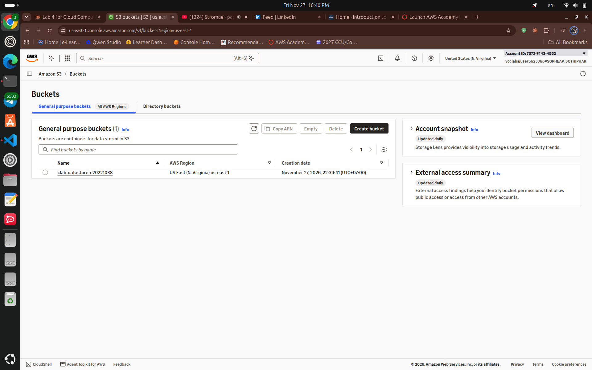
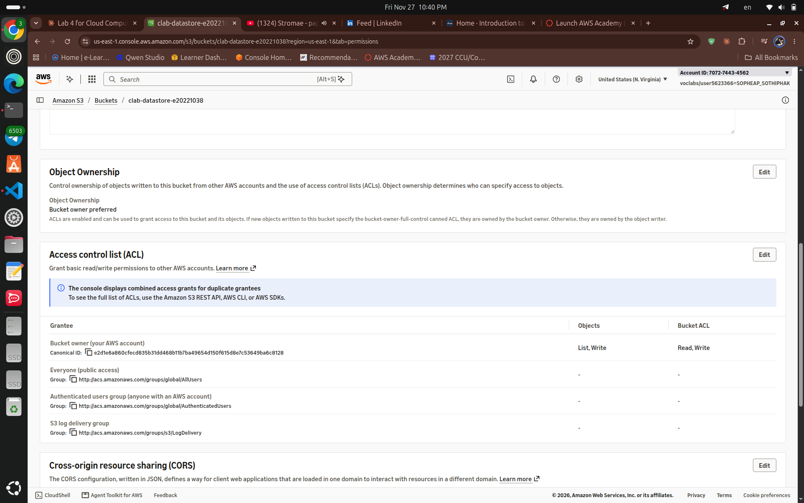
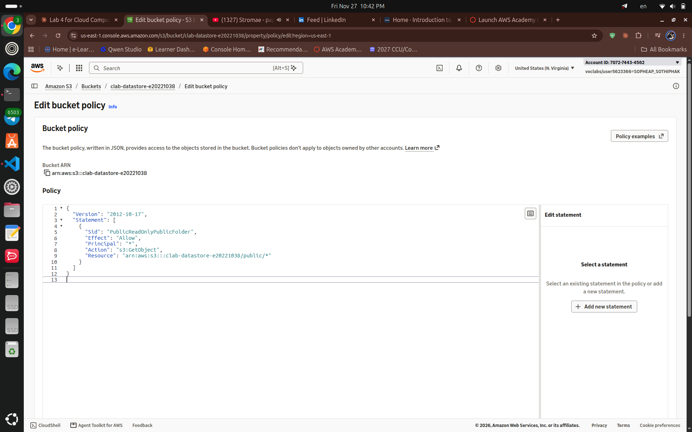
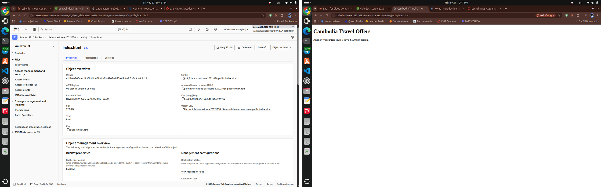
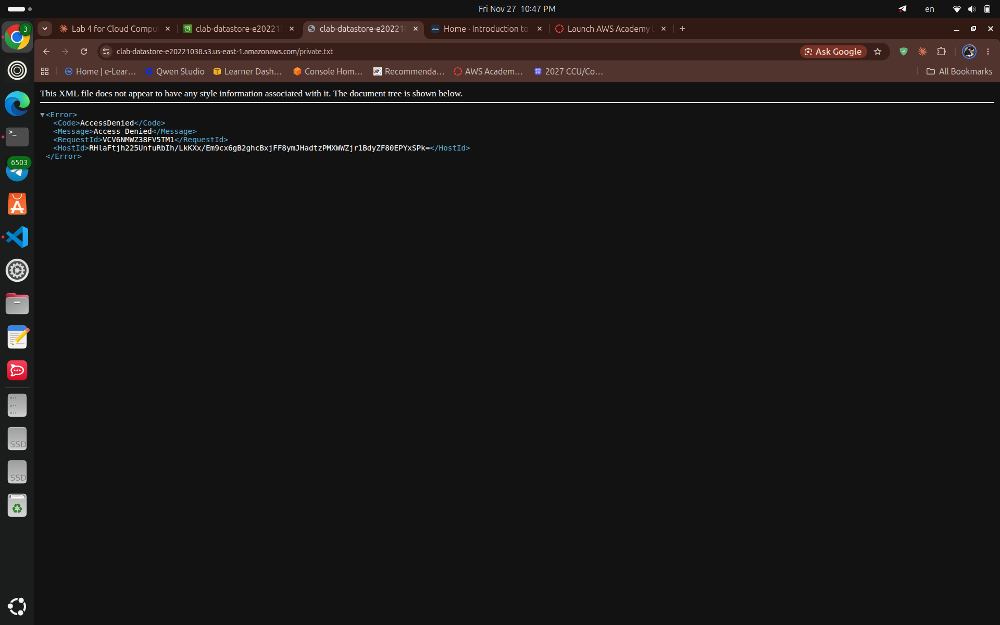
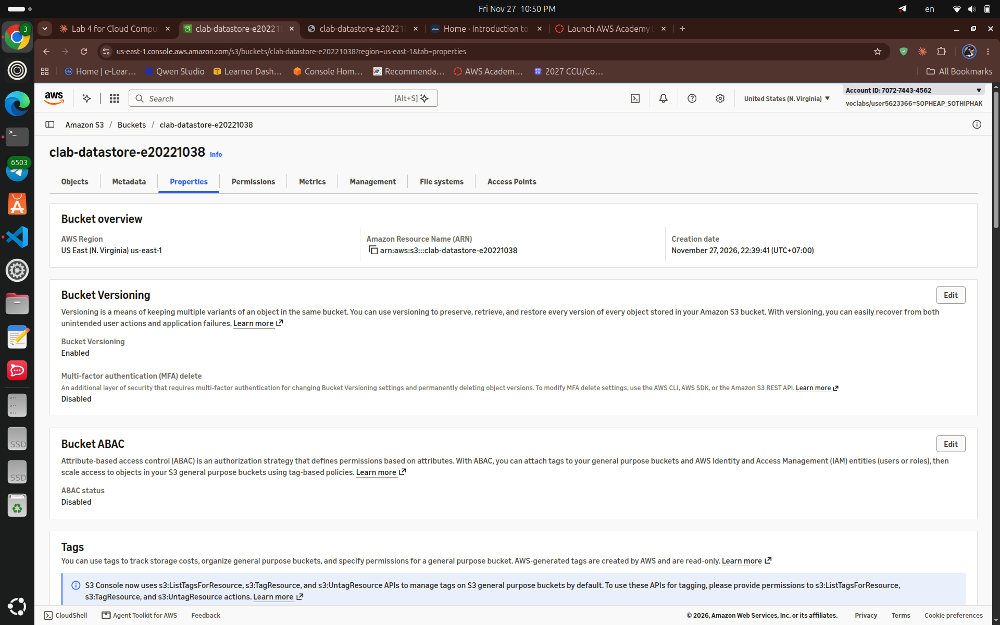
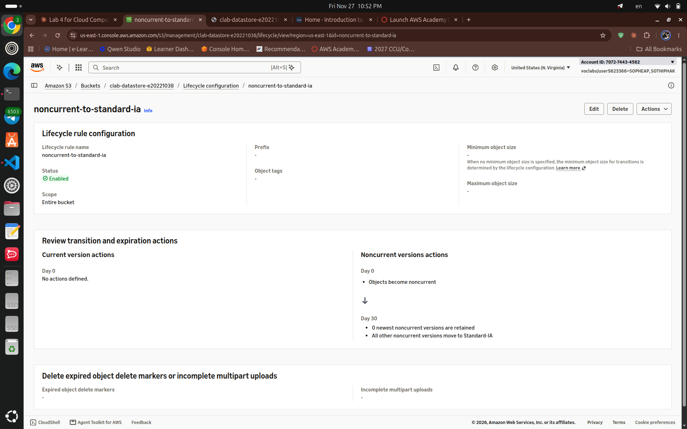

# Cloud Lab 3 Challenge Submission — Secure S3 Bucket

- **Student name:** Sopheap Sothiphak
- **Student ID:** e20221038
- **Learner Lab user name:** voclabs/user5623366=SOPHEAP_SOTHIPHAK
- **Bucket name:** clab-datastore-e20221038
- **Date completed:** 27 November 2026

---

## 1. Bucket

The bucket `clab-datastore-e20221038` in US East (N. Virginia) `us-east-1`.



## 2. Object ownership

Object Ownership is set to **Bucket owner preferred**, so ACLs are enabled.



## 3. Public access policy

The policy editor with the whole bucket policy.



`public/index.html` with its object URL (left), and the page loaded in the browser through that URL (right).



`private.txt` is in the bucket root. Its object URL returns `AccessDenied`.



My policy is in [bucket-policy.json](bucket-policy.json). The line that limits public access to the `public/` folder is:

```json
"Resource": "arn:aws:s3:::clab-datastore-e20221038/public/*"
```

The statement allows only `s3:GetObject` for everyone (`"Principal": "*"`), and only on objects whose key starts with `public/`. The bucket itself and every other key have no allow statement, so they stay private.

## 4. Versioning



## 5. Lifecycle rule

The rule `noncurrent-to-standard-ia` applies to the entire bucket. Noncurrent versions move to S3 Standard-IA 30 days after they become noncurrent.



---

## Questions

1. **You turned off parts of Block Public Access for this bucket. Why was that needed, and why is it still safe for the objects outside `public/`?**

   Block Public Access overrides bucket policies. With the settings that block public bucket policies turned on, S3 refuses to save a policy that gives access to `"Principal": "*"`, and it would block the access even if the policy were saved. So I had to turn those settings off for this bucket. It is still safe for the other objects because the only thing that grants public access is my policy, and it covers only `public/*`. Nothing allows access to any other key, so S3's default deny applies. My test showed this: `public/index.html` loaded, and `private.txt` in the root returned `AccessDenied`.

2. **What is a noncurrent version? Give an example from your own test.**

   With versioning enabled, S3 keeps every version of an object. The newest version is the current one, and every older version of the same key is a noncurrent version. In my test I uploaded `public/index.html` first with the price "$120 per person". Then I uploaded a new `index.html` with the price "$99 per person (new price)". The second file became the current version, and the first one became a noncurrent version. With **Show versions** turned on, both are listed.

3. **Why move noncurrent versions to S3 Standard-IA instead of deleting them?**

   Old versions are needed only rarely, for example to roll back a bad page update, so they don't need the more expensive S3 Standard class. Standard-IA costs less per GB for data that is not accessed often, and the data is still available immediately when needed. Deleting them would save even more but would lose the history the content team wants to keep. Moving them keeps the versions and lowers the cost.

## AI note

I used an AI assistant (Claude) to guide me through the console steps and to draft `bucket-policy.json` and the test files. I checked the result myself in the browser: the object in `public/` loaded, the object in the bucket root returned `AccessDenied`, and I confirmed the versioning and lifecycle settings in the console. I wrote the answers to the questions from what I saw in my own tests.

## Clean up

- [x] All object versions deleted and the bucket deleted.
