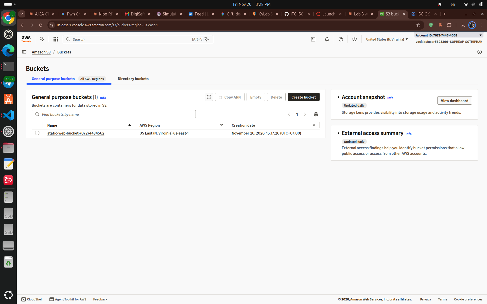
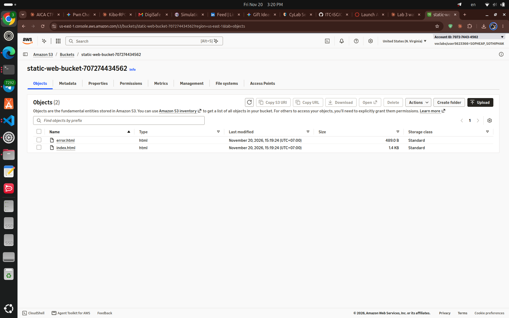
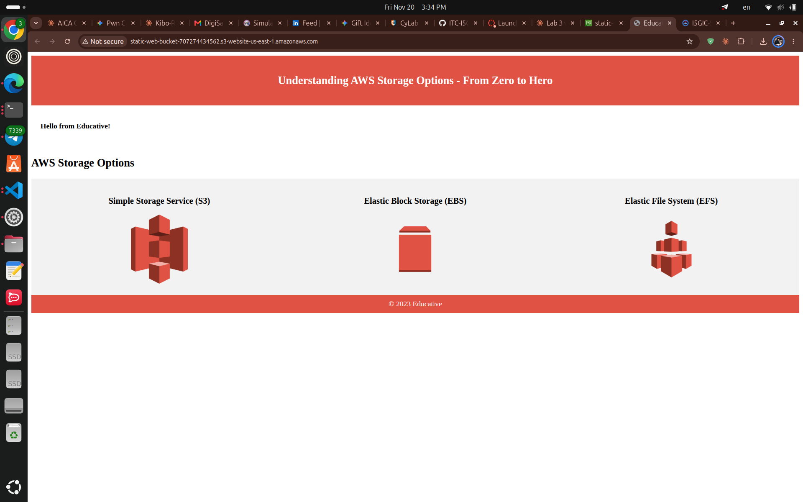
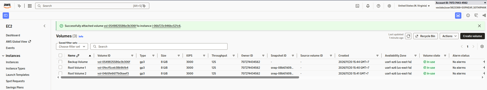
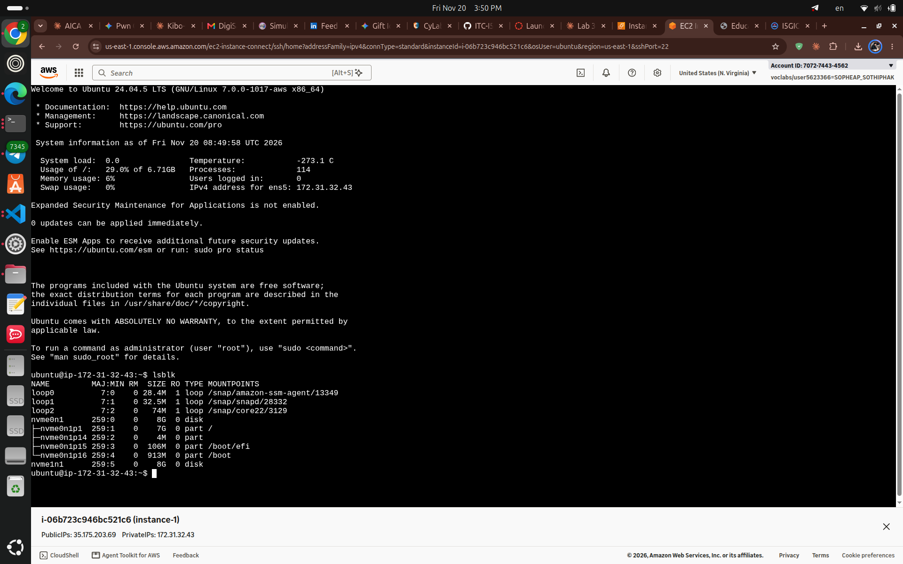
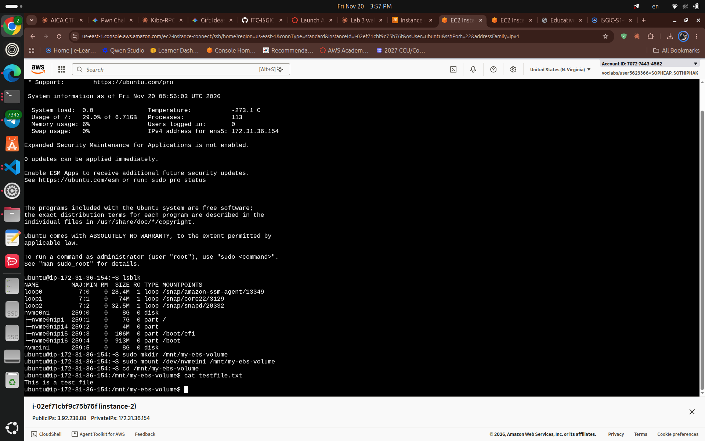
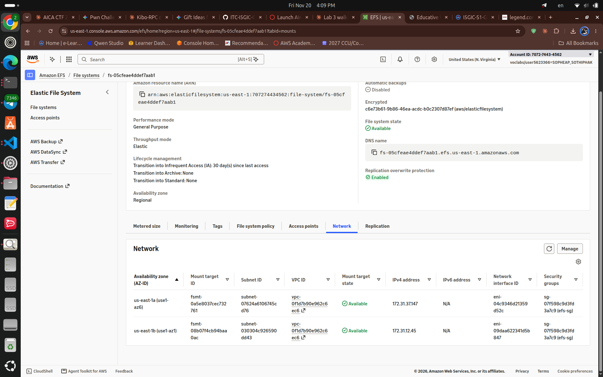
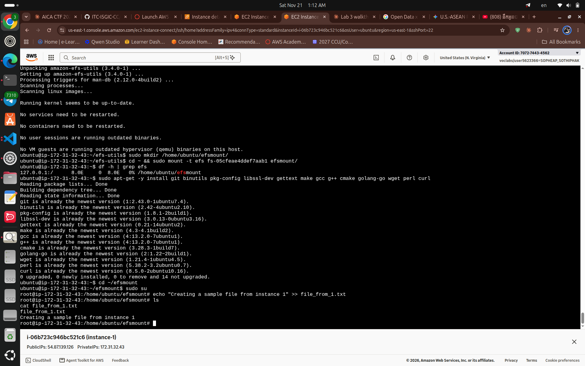
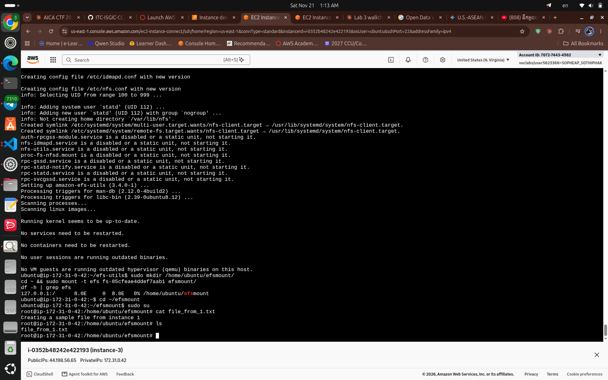

# Cloud Lab 3 Submission — AWS Storage Options

- **Student name:** Sopheap Sothiphak
- **Student ID:** e20221038
- **Learner Lab user name:** voclabs/user5623366=SOPHEAP_SOTHIPHAK
- **Date completed:** 2026-11-06

---

## Part 2.1 — Amazon S3

### Bucket list

### Uploaded files

### Static website

---

## Part 2.2 — Amazon EBS

### Volumes page

### Attached volume (`lsblk`)

Which device name did your volume get (`xvdf`, `nvme1n1`, ...)?

**`nvme1n1`.** I attached the volume as `/dev/sdf`, but `instance-1` is a t3 instance, so Linux shows EBS volumes as NVMe devices. The root volume was `nvme0n1` and the new 8 GiB disk with no partitions and no mount point was `nvme1n1`. On `instance-2` it got the same name.

### File read on instance-2

---

## Part 2.3 — Amazon EFS

### File system and mount targets

### File created on instance-1

### File listed on instance-3

---

## Questions

1. After you turned on static website hosting, the endpoint first answered **403 Forbidden**. Why, and what changed after you added the bucket policy?

   S3 denies access by default. I had turned off Block Public Access, but that only removes the safety block and does not give anyone permission, so no rule allowed the public to read the objects. The endpoint could not even load `error.html`, so it showed the 403 page. After I added the bucket policy with `"Principal": "*"`, `"Effect": "Allow"` and `"Action": "s3:GetObject"` on `arn:aws:s3:::static-web-bucket-707274434562/*`, everyone could read the objects in the bucket, and the endpoint served `index.html`.

2. `testfile.txt` was still there after you moved **Backup Volume** to `instance-2`. What would have happened to a file saved on `instance-1`'s **root** volume after terminating `instance-1`?

   The file would have been lost. A root volume is deleted when its instance is terminated, so everything on it goes too. The extra volume, **Backup Volume**, exists independently of any instance. That is why `testfile.txt` survived being detached from `instance-1` and attached to `instance-2`.

3. Why did you run `mkfs` on `instance-1` but not on `instance-2`?

   A new EBS volume is raw, unformatted storage, so on `instance-1` I had to create an `ext4` file system with `mkfs` before I could mount and use it. `mkfs` erases everything on the disk. By the time I moved the volume to `instance-2`, it already had a file system with `testfile.txt` on it, so I only needed to mount it. Running `mkfs` again would have wiped the file.

4. Why could `instance-1` and `instance-3` use the EFS file system at the same time, when an EBS volume had to be detached first? Why did they have to be in the subnets of the mount targets?

   An EBS volume is block storage that works like a single disk attached to one instance at a time, so I had to detach it from `instance-1` before attaching it to `instance-2`. EFS is a managed network file system (NFS) that allows parallel access, so many instances can mount it at once, and it uses file locking to keep the data consistent. Instances reach EFS through a mount target, which gives an IP address for the NFS endpoint in one Availability Zone. Each instance connects through the mount target in its own AZ, so `instance-1` (us-east-1a) and `instance-3` (us-east-1b) had to be in the subnets where I created the mount targets. The `efs-sg` security group also had to allow NFS traffic to those mount targets.

5. For each need, choose S3, EBS or EFS and give one reason: (a) a website's images, (b) the disk of a database server, (c) a folder shared by several web servers.

   - (a) **S3**: it stores objects such as images cheaply at any scale and serves them over HTTP, as in my static website.
   - (b) **EBS**: it is block storage that acts like a disk, with low latency, and it persists independently of the server.
   - (c) **EFS**: it is a shared file system that many servers can mount and use at the same time.

## Problems and how I solved them (optional)

- **Wrong Ubuntu version by default.** The launch wizard offered Ubuntu 26.04, but the lab uses 24.04. I changed the AMI to Ubuntu Server 24.04 LTS before launching, which I confirmed in the Summary panel.
- **Removed a mount target by accident.** When customizing EFS I removed the us-east-1b row. I clicked **Add mount target** and added us-east-1b back, then made sure both rows used `efs-sg`.
- **Build of `efs-utils` was interrupted.** My Instance Connect session disconnected during the long build. I reconnected and ran the build in the background with `nohup ./build-deb.sh > ~/build.log 2>&1 &`, so a dropped connection could not stop it.
- **"No space left on device" while installing.** The 8 GiB root disk was filled by the Rust toolchain and build files. I copied the `.deb` to my home folder, deleted the build output (`~/efs-utils/src/target`, `~/.cargo/registry`), ran `sudo apt-get clean`, and the install then worked. I did the same cleanup on `instance-3` before installing.

## AI note (optional)

An AI assistant told me that on t3 instances the new EBS volume appears as an NVMe device (probably `nvme1n1`) and not `xvdf`, so I should not copy the device name from the instructions. I checked by running `lsblk` and saw the 8 GiB disk with no partitions was `nvme1n1`. Then I used that name in `mkfs` and `mount`.

## Clean up

- [x] Instances `instance-1`, `instance-2`, `instance-3` terminated.
- [x] `clab-efs` and **Backup Volume** deleted.
- [x] Security groups `efs-sg` and `ec2instances-sg` deleted.
- [x] S3 bucket emptied and deleted.
