# Cloud Lab 4 Submission — Amazon VPC

- **Student name:** Sopheap Sothiphak
- **Student ID:** e20221038
- **Learner Lab user name:** voclabs/user5623366=SOPHEAP_SOTHIPHAK
- **Date completed:** 27 November 2026

---

## VPC and internet gateway

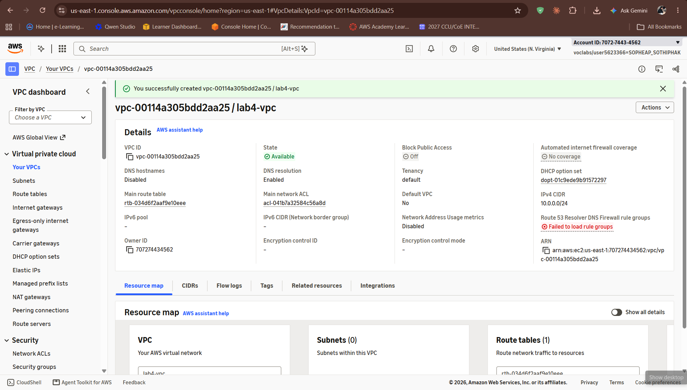

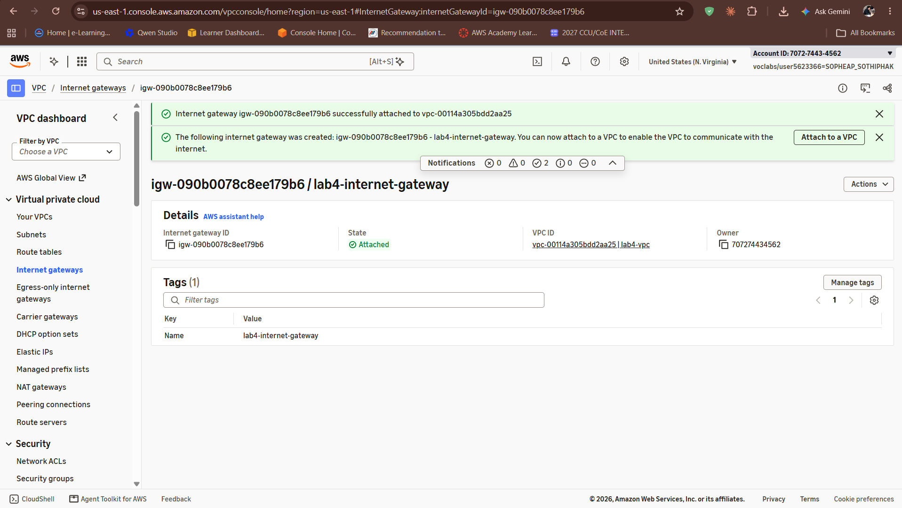

## Public subnet

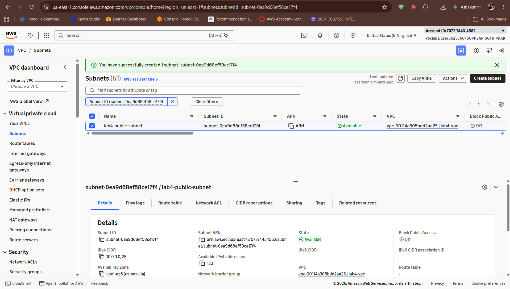

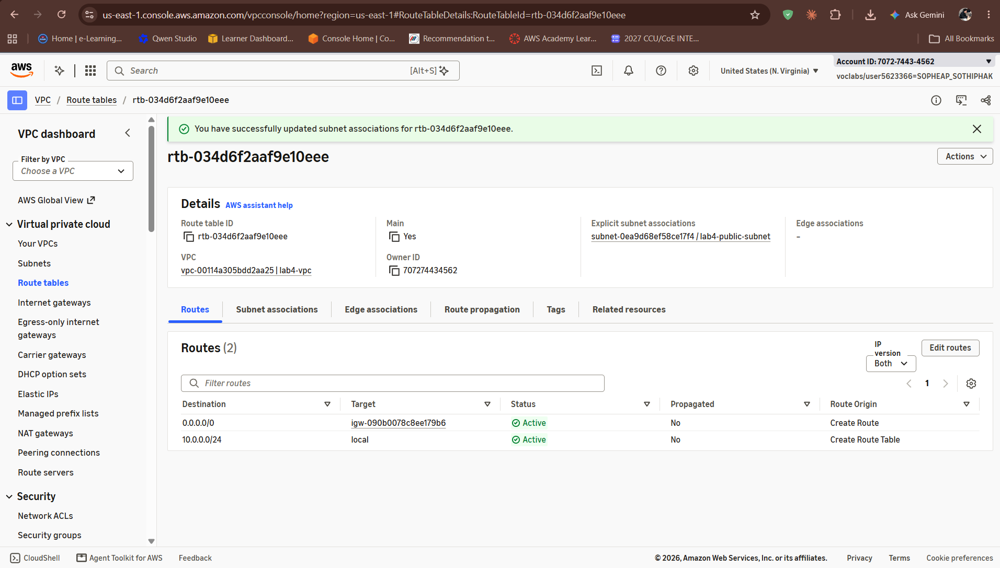

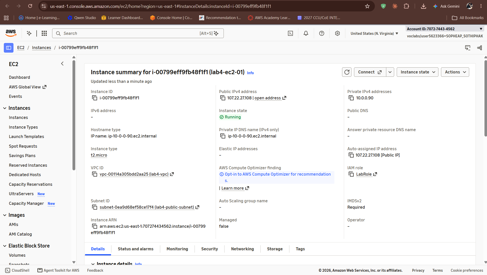

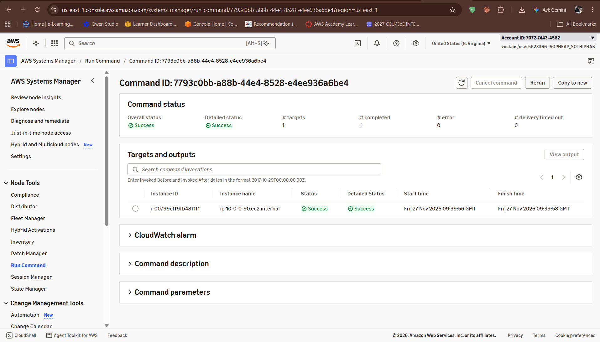

## Private subnet

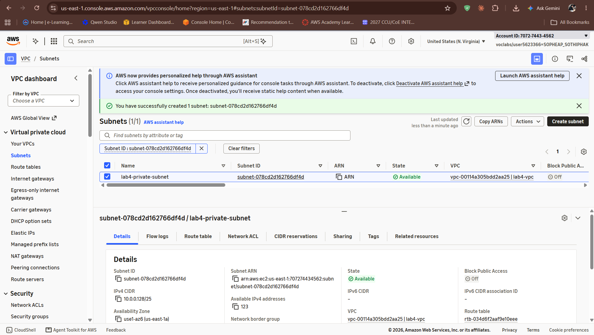

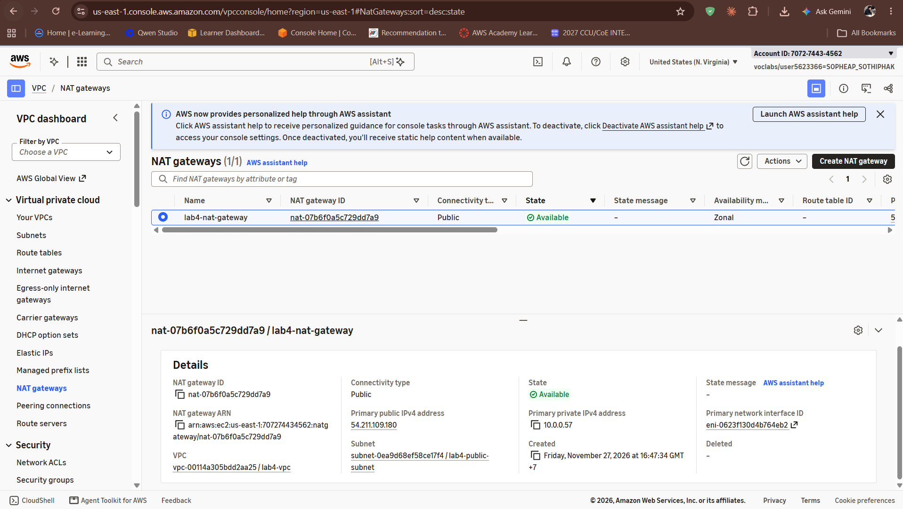

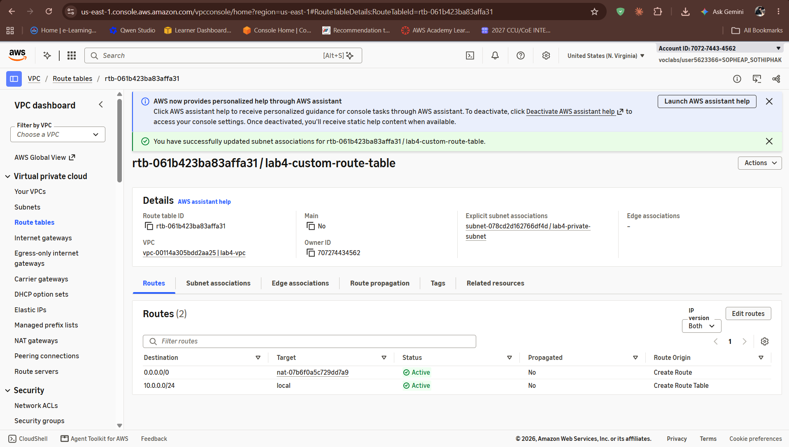

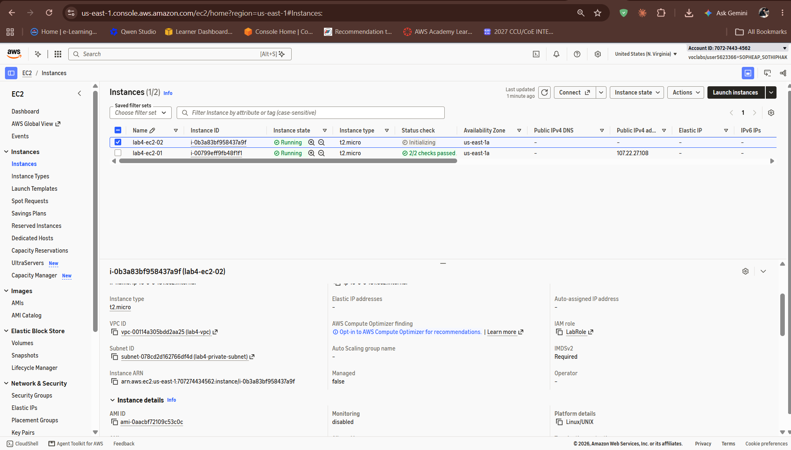

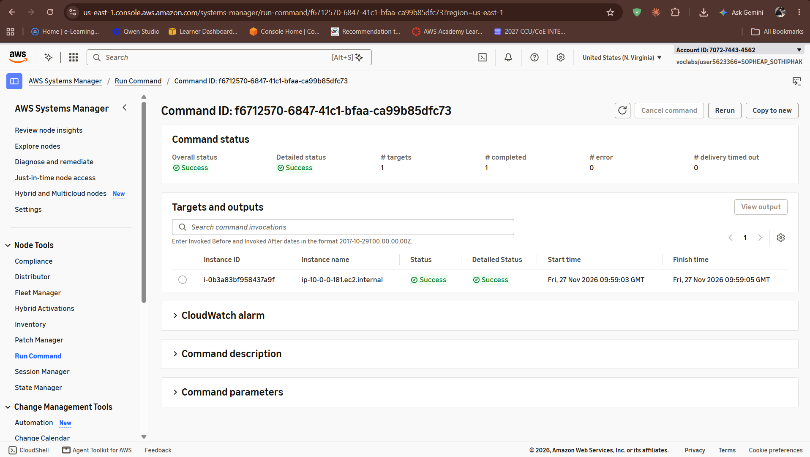

---

## Questions

**1. The VPC is `10.0.0.0/24` and the subnets are `10.0.0.0/25` and `10.0.0.128/25`. How many IP addresses does each block contain, and why do the two subnets not overlap?**

The `/24` VPC block has 2^(32-24) = 256 addresses. Each `/25` subnet has 2^(32-25) = 128 addresses (AWS reserves 5 in every subnet, so 123 are usable). The subnets do not overlap because they differ in the first host bit: `10.0.0.0/25` covers `10.0.0.0`–`10.0.0.127` and `10.0.0.128/25` covers `10.0.0.128`–`10.0.0.255`. Together they use exactly the whole `/24`, and both are inside the VPC range.

**2. Both subnets are in the same VPC. What exactly makes `lab4-public-subnet` public and `lab4-private-subnet` private?**

The route table. The public subnet is associated with a route table that has `0.0.0.0/0` → `lab4-internet-gateway`, so its instances (which also have a public IP) can send and receive traffic directly with the internet. The private subnet is associated with `lab4-custom-route-table`, whose default route `0.0.0.0/0` goes to the NAT gateway and not to the internet gateway, so nothing on the internet has a route back into it. The name does not matter; the route to the internet gateway does.

**3. Why is the NAT gateway placed in the public subnet and not in the private one?**

The NAT gateway must itself reach the internet. It does this through the internet gateway, and only the public subnet has a route to it. It also needs an Elastic IP, which it uses as the public source address for the private instances' traffic. A NAT gateway inside the private subnet would have no path to the internet gateway, so it could not forward anything.

**4. `lab4-ec2-02` has no public IP address. Can someone on the internet open a connection to it? Can it download updates? Explain both answers.**

No inbound: it has no public IP, its subnet has no route to the internet gateway, the NAT gateway only allows replies to connections that started inside, and its security group has no inbound rules. Yes outbound: its traffic goes `0.0.0.0/0` → NAT gateway, which translates the private source address to its Elastic IP and sends it out through the internet gateway; replies come back the same way. This is why `sudo yum update -y` succeeded in Task 11.

**5. You tested internet access with Systems Manager instead of SSH. Why did the instances need `LabInstanceProfile` for this?**

The SSM agent on the instance needs AWS credentials to register with Systems Manager and receive Run Command jobs. `LabInstanceProfile` attaches `LabRole` to the instance and provides these permissions. Without it the instance does not show up as a managed node and cannot be selected in Run Command. No SSH key or inbound port is needed because the agent makes outbound connections to Systems Manager.

## Problems and how I solved them (optional)

- **Amazon Linux 2 not available.** The Amazon Linux 2 AMI did not appear in Quick Start, Community AMIs or the Marketplace search in my Learner Lab, so I used Amazon Linux 2023 (x86_64, t2.micro) for both instances. `sudo yum update -y` works the same way (yum is an alias of dnf) and the SSM agent is preinstalled.
- **NAT gateway form.** The console offered *Regional* availability mode by default, which has no subnet field. I chose *Zonal* so I could place the NAT gateway in `lab4-public-subnet` as the lab requires.
- **Route table not listed.** The route table list was stale and showed only the default VPC's table. After refreshing, the `lab4-vpc` route table (`rtb-034d6f2aaf9e10eee`) appeared.
- **Elastic IP would not release.** The release failed with "Cannot be released with association IDs" because the NAT gateway was still being deleted. I waited until the NAT gateway was *Deleted*, reloaded the page, and then released it.

## AI note (optional)

An AI assistant suggested choosing *Zonal* mode for the NAT gateway. I checked it on the NAT gateway details page, which shows subnet `lab4-public-subnet` and the Elastic IP `54.211.109.180`, and the private instance's `yum update` then succeeded through it.

## Clean up

- [x] Instances terminated.
- [x] NAT gateway deleted and its Elastic IP released.
- [x] Internet gateway detached and deleted.
- [x] `lab4-vpc` deleted.
