# Cloud Lab 5 Submission — AWS Database Lab

- **Student name:** Sopheap Sothiphak
- **Student ID:** e20221038
- **Learner Lab user name:** voclabs/user5623366=SOPHEAP_SOTHIPHAK
- **Date completed:** 20 November 2026

---

## 1. Security Group Rules

`aws-database-options-security-group` with its inbound rules (SSH port 22, Custom TCP ports 8000 and 5173) and its outbound rule.

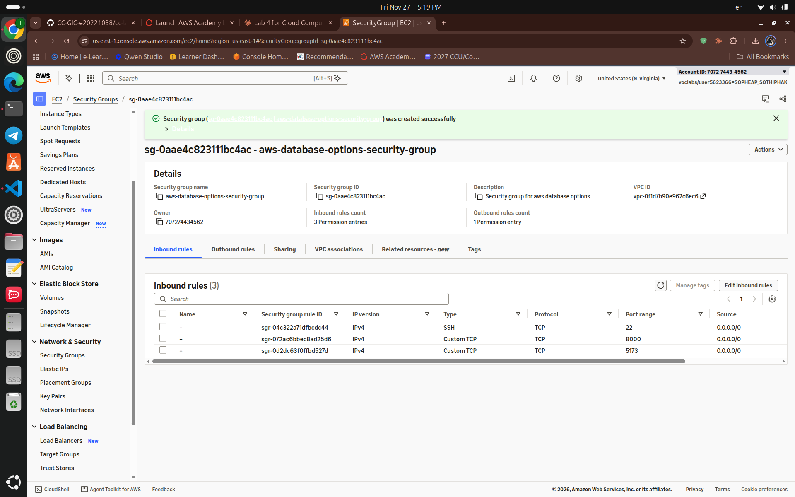

## 2. EC2 Instance Running

`aws-database-options-lab-instance` in the **Running** state with `aws-database-options-security-group` attached.

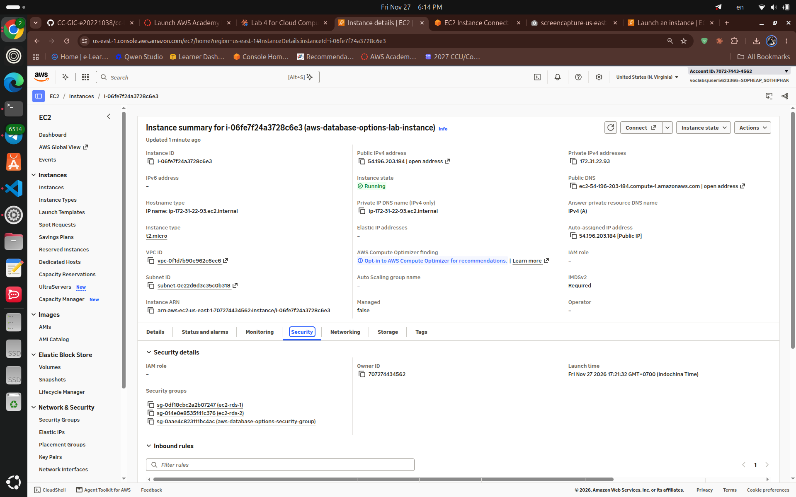

## 3. S3 Bucket

Bucket `clab-imagestore-e20221038` with "Block all public access" turned off and the public-read bucket policy visible.

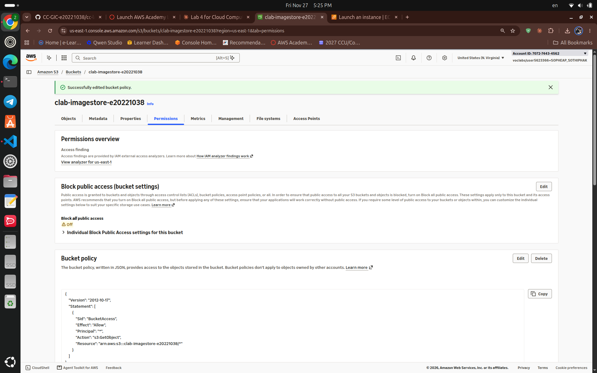

## 4. RDS DB Instance

`aws-dbo-sql` (MySQL 8.4, `db.t4g.small`) with the status **Available** and its endpoint visible.

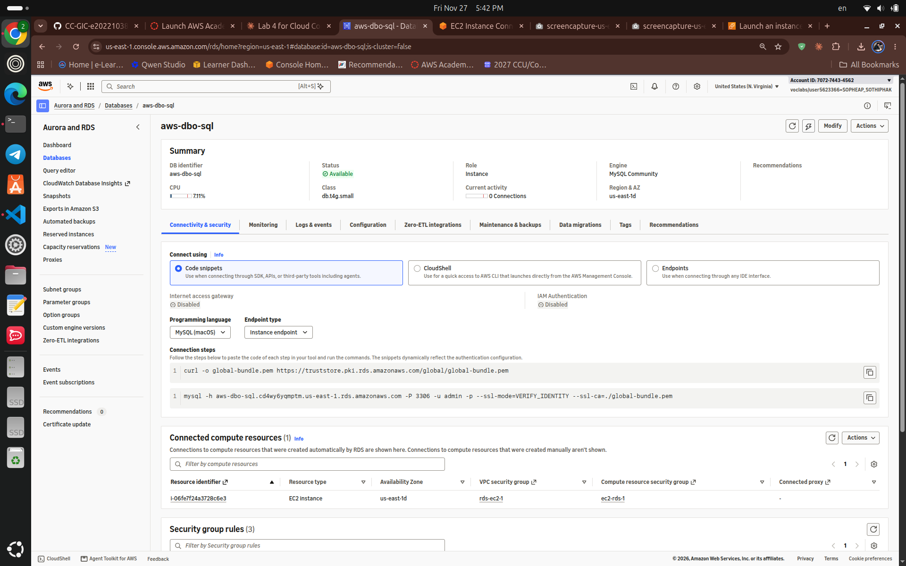

## 5. Aurora DB Status

The `aws-dbo-aurora` cluster with the status **Available** and its writer and reader endpoints visible.

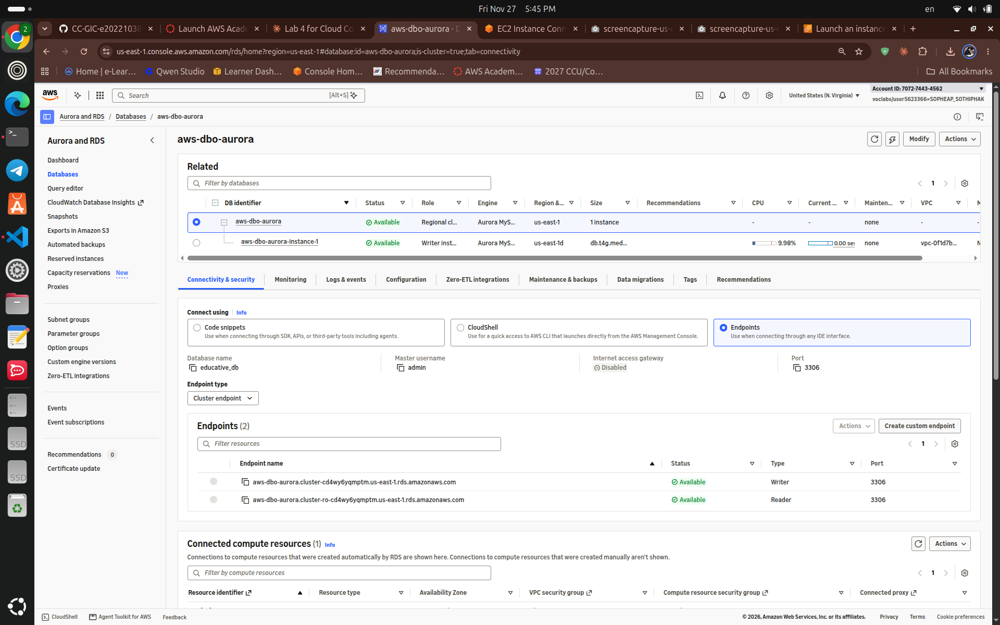

## 6. DynamoDB Table

The `posts` table with the status **Active** and its partition key `post_id` (String).

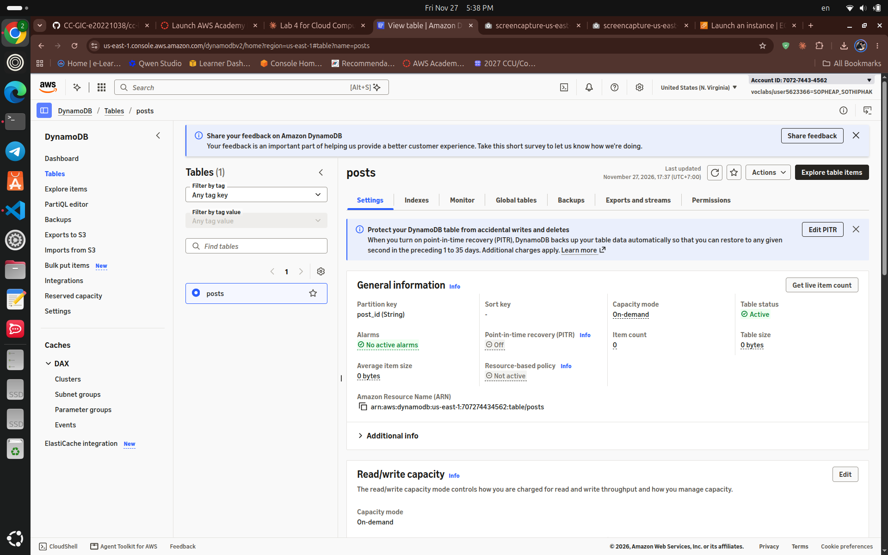

## 7. Application Configuration and Testing

The EC2 instance terminal after `npm start`: Vite is ready on port 5173 and Uvicorn is running on port 8000.

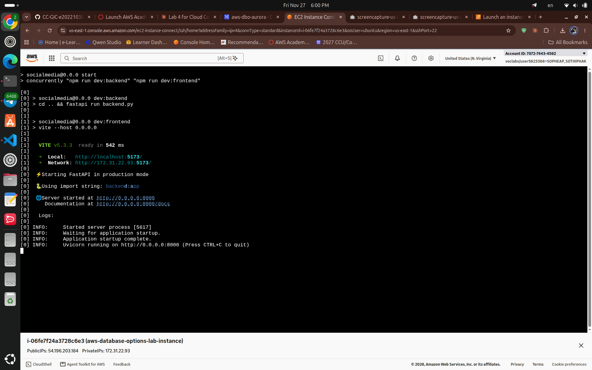

The application running in the browser at `http://54.196.203.184:5173`.

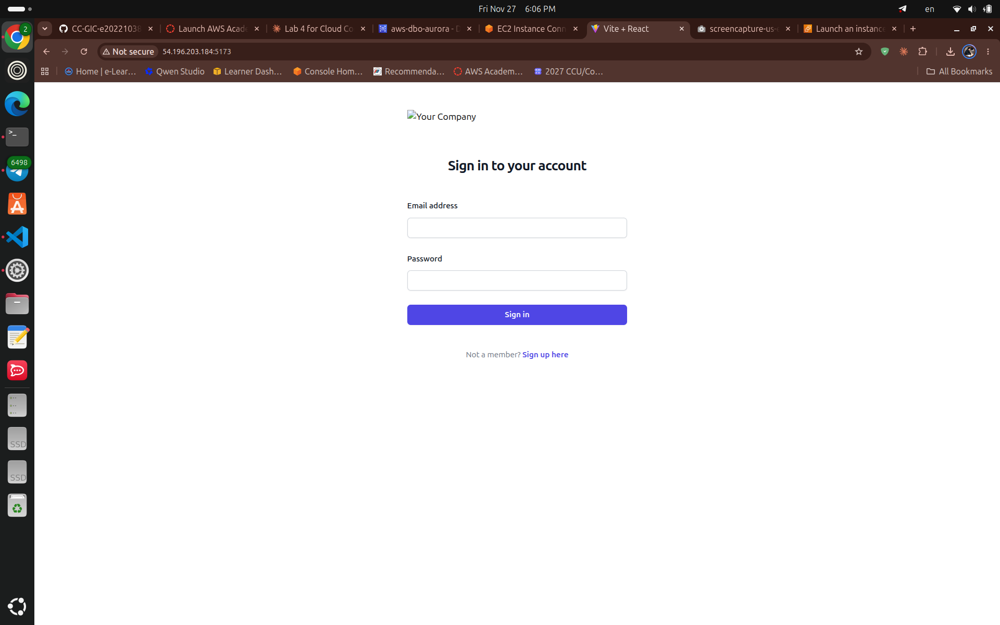

## 8. Final Infrastructure

Collage of the resources created: EC2 instance with its security group, the security group rules, the RDS and Aurora databases, the Aurora writer and reader endpoints, the DynamoDB table and the S3 bucket.

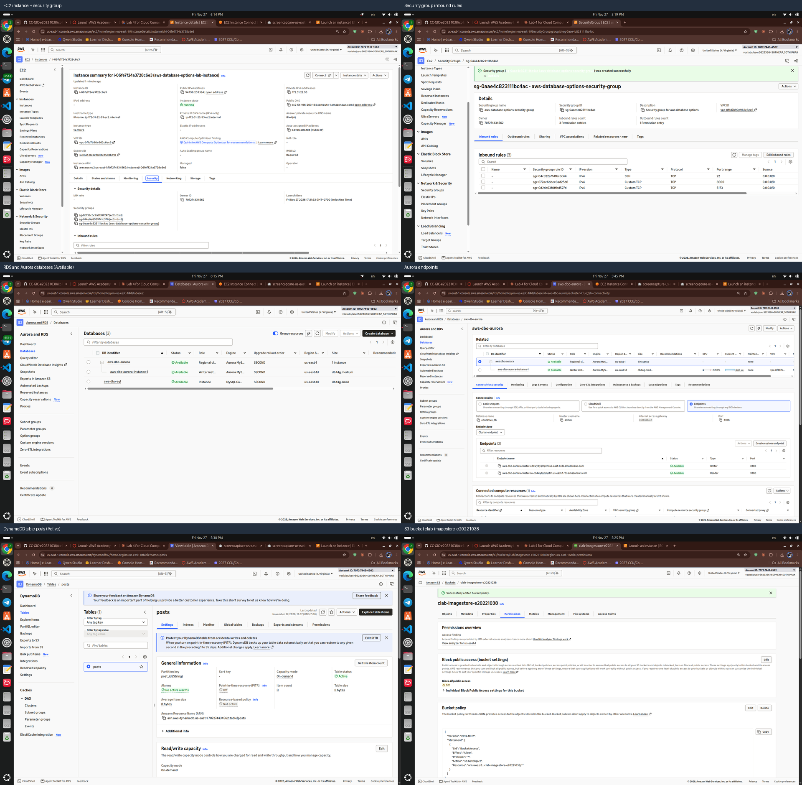

## 9. Signup and Sample Post

Signing in to the application and the sample post `Lab 5 - e20221038` in the feed.

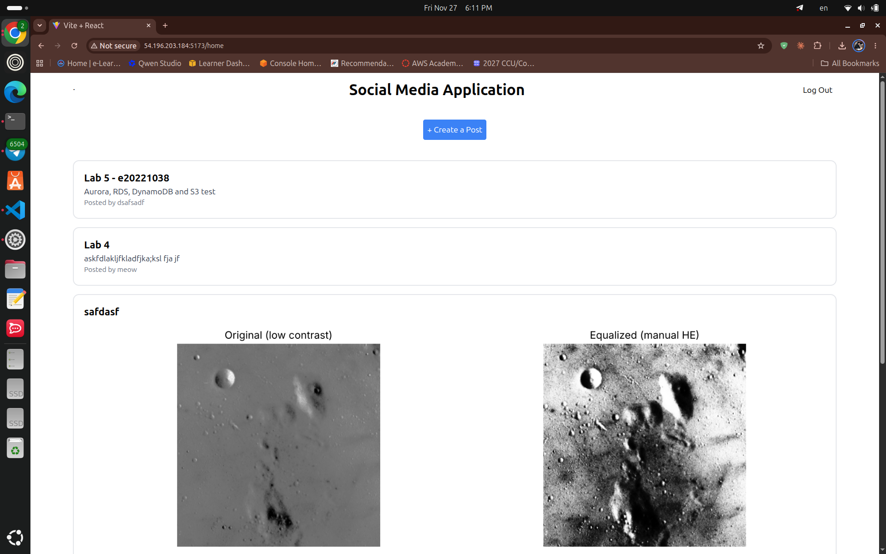

## Errors and troubleshooting

**1. Wrong "Create" button for the database.** The first time, I clicked the "Create" button under the express configuration instead of the full one. I went to Databases → Create database → Full configuration and chose "Self managed" for the master password, as the lab asks.

**2. `EACCES: permission denied` when starting Vite.** The `/DatabaseOptions` folder was owned by root, so Vite could not write its temporary config file. The backend started but the frontend exited with code 1. I fixed it with `sudo chown -R ubuntu:ubuntu /DatabaseOptions` and ran `npm start` again.

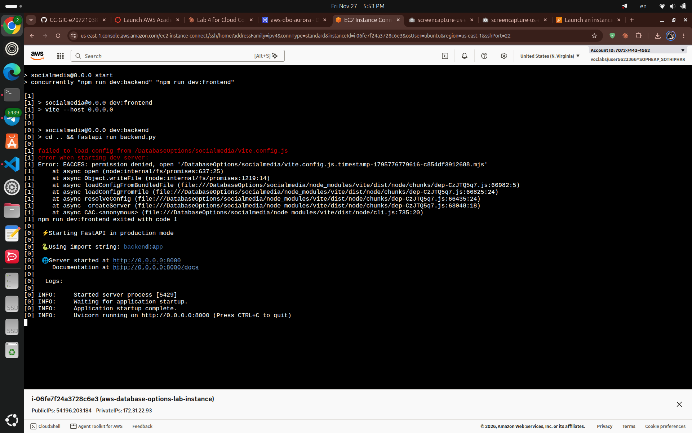

**3. Placeholders left in `backend.py`.** After filling in the hosts, passwords and keys, `grep '<Your'` still found `<Your AuroraDB SQL Database>`, `<Your RDS SQL Database>`, `<Your AWS Access Key>` and `<Your AWS Secret Key>`. I replaced the database names with `educative_db` and filled in the keys. The file also had no session token, so I added `SESSION_TOKEN` and passed `aws_session_token` to the boto3 session and the S3 client. The Learner Lab keys start with `ASIA`, which means they are temporary and only work with a session token.

**4. Page blocked by the network web filter.** Opening `http://54.196.203.184:5173` on the campus network showed a FortiGuard "Access Blocked" page for an unrated IP address. I switched the computer to my phone hotspot and the page loaded.

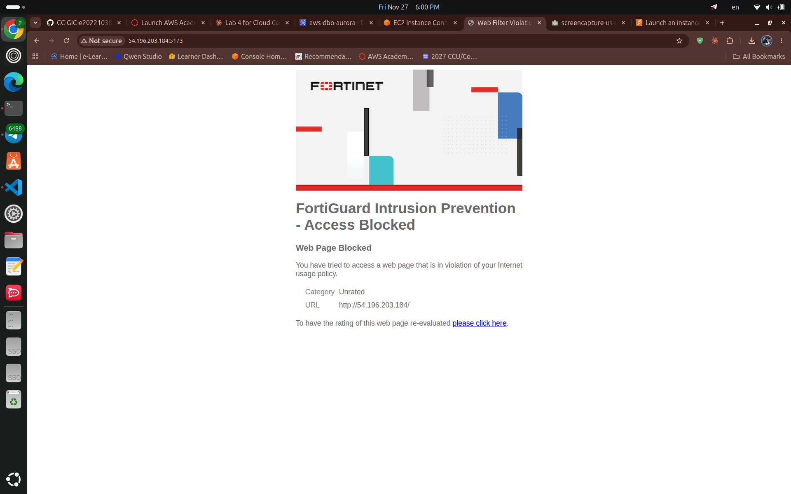

**5. App stopped after changing network.** Switching networks closed the EC2 Instance Connect session and stopped `npm start` ("connection refused" on port 5173). I reconnected and started the app again with `setsid nohup npm start > /tmp/app.log 2>&1 &` so it keeps running if the terminal disconnects.

---

## Questions

1. **Signup writes to the Aurora writer endpoint and login reads from the reader endpoint. Your cluster has no Aurora Replica. Which instance answers the reader endpoint, and why does the application still work?**

   The only instance in the cluster, `aws-dbo-aurora-instance-1`, which is the writer, answers the reader endpoint as well. The reader endpoint load-balances across the available read replicas, and when there are none it falls back to the writer instance. The application works because that single instance can handle both reads and writes. The cost is that there is no read scaling and no standby for failover.

2. **A post is split between the `user_post` table in RDS and the `posts` table in DynamoDB. What does each one store, and how does `/get_posts` join them?**

   The `user_post` table in RDS stores only the post `id` (username plus time) and the `username`, so it links a post to its author. The `posts` table in DynamoDB stores the post details under the partition key `post_id`: `title`, `content` and the optional `media` URL of the file in S3. `/get_posts` runs `SELECT id, username FROM user_post` on RDS and then, for each row, calls `get_item(Key={'post_id': id})` on DynamoDB. It adds the username to the item it gets back and returns the combined list. So the join is done in the application code, not in a database.

3. **The post ID is the username followed by the time (`%H:%M:%S`). What happens if the same user publishes two posts in the same second, or on two different days at the same time?**

   In both cases the two posts get the same ID, because the ID has no date or counter. In RDS, `id` is the `PRIMARY KEY` of `user_post`, so the second `INSERT` fails with a duplicate-key error and the API returns "Error creating Post". The second post is rejected and the user has to try again. In DynamoDB, `put_item` with an existing `post_id` replaces the old item. That does not happen in this app, because the SQL insert runs first and fails, but it would silently overwrite the first post if the order were reversed or the SQL check were missing. Adding the date or a UUID to the ID would fix this.

4. **Why does the post content go into DynamoDB instead of a SQL table, according to the lab's database design?**

   According to the lab, post data can differ from post to post: some posts have certain fields, such as a media URL, and others don't. DynamoDB is a NoSQL database with a flexible schema, so each item only stores the attributes it needs, and it keeps fast, predictable read and write times at any scale. SQL tables suit data where every row has the same fields, like `users` and `user_post`.

5. **The `users` table stores the password exactly as the user typed it, and the S3 bucket allows anyone to read its objects. Name one risk of each choice.**

   - **Plain-text passwords:** anyone who gets read access to the database (a leak, a backup, or an admin) can read every user's password and can try it on the user's other accounts. Passwords should be hashed with a salt, for example with bcrypt or Argon2.
   - **Public-read bucket:** anyone on the internet who knows or guesses an object URL can view the uploaded files, including private ones, and there is no access control per user. The data can also be copied and shared freely, and you pay for the bandwidth. Better options are a private bucket with pre-signed URLs or CloudFront with restricted access.

## Clean up

- [x] EC2 instance terminated and `aws-database-options-security-group` deleted.
- [x] RDS instance `aws-dbo-sql` and Aurora cluster `aws-dbo-aurora` deleted.
- [x] S3 bucket emptied and deleted.
- [x] DynamoDB table `posts` deleted.
